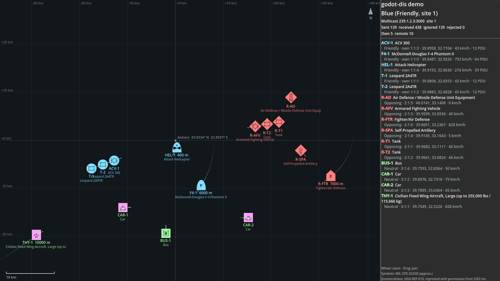

# godot-dis

DIS (IEEE 1278.1, Distributed Interactive Simulation) for Godot 4: connect a Godot game or simulator to a DIS
exercise — entities, weapon fire and detonations, exercise control (start / stop / remove), recording and playback.
A C++ GDExtension built on [Open-DIS](https://github.com/open-dis/open-dis-cpp) (BSD-2-Clause) and godot-cpp.

**Status:** in development, not released yet. Builds and tests pass on Windows and Linux; macOS is built by CI only.



## Features
- **14 PDU types:** Entity State, Fire, Detonation, Collision, the simulation management set (Create / Remove
  Entity, Start/Resume, Stop/Freeze, Acknowledge, Set Data, Data, Comment) and radio (Transmitter, Signal), DIS 7
  (older versions are read too), each verified byte for byte against Open-DIS Python, a capture from opendis7-java
  and Wireshark's DIS dissector — see the [PDU support](#pdu-support) table and
  [docs/interoperability.md](docs/interoperability.md)
- `DisNetwork`: UDP broadcast / unicast / multicast, exercise and own-packet filters, several DIS applications
  sharing one port, a signal per PDU type — [docs/networking.md](docs/networking.md)
- `DisGeoOrigin`, `DisGeo`: WGS84 geodetic ↔ ECEF ↔ local ENU ↔ Godot, DIS Euler angles ↔ `Basis`, in doubles
  — [docs/coordinates.md](docs/coordinates.md)
- `DisEntity` (publish a node: thresholds, heartbeat; `fire()` / `detonate()`), `DisEntityManager` (remote entities:
  dead reckoning DRM 1–5, smoothing, timeouts, ground clamping on any terrain with `height_at`), entity type → scene
  mapping — [docs/entities.md](docs/entities.md), [docs/warfare.md](docs/warfare.md)
- `DisExerciseControl`: obey a simulation manager (start, freeze at a given time, resume, remove entities,
  acknowledge) or be one (requests with retries) — [docs/simulation-management.md](docs/simulation-management.md)
- `DisRadioMonitor`: which entity has which radio on which frequency, and who is on the air right now (no audio)
  — [docs/radio.md](docs/radio.md)
- `DisRecorder`, `DisPlayer`, `DisRecording`: record to **pcapng** (opens in Wireshark) or a plain-text PDU log, play
  back into the scene or onto the network with speed, pause and seek; reads Wireshark / tcpdump captures; command
  line tool — [docs/recording.md](docs/recording.md)
- `DisEnums`: SISO-REF-010 names and DIS entity type → MIL-STD-2525D symbol codes for
  godot-milsymbol — [docs/enumerations.md](docs/enumerations.md)

## PDU support

| PDU (type) | Send | Receive | Godot API | Checked against |
|---|:-:|:-:|---|---|
| Entity State (1) | ✔ | ✔ | `DisEntityStatePdu`, `DisEntity`, `DisEntityManager` | Open-DIS Python, opendis7-java, Wireshark, Wireshark samples |
| Fire (2) | ✔ | ✔ | `DisFirePdu`, `DisEntity.fire()` | Open-DIS Python, opendis7-java, Wireshark |
| Detonation (3) | ✔ | ✔ | `DisDetonationPdu`, `DisEntity.detonate()` | Open-DIS Python, opendis7-java, Wireshark |
| Collision (4) | ✔ | ✔ | `DisCollisionPdu` | Open-DIS Python, opendis7-java, Wireshark |
| Create Entity (11) | ✔ | ✔ | `DisCreateEntityPdu`, `DisExerciseControl` | Open-DIS Python, opendis7-java, Wireshark |
| Remove Entity (12) | ✔ | ✔ | `DisRemoveEntityPdu`, `DisExerciseControl` | Open-DIS Python, opendis7-java, Wireshark |
| Start/Resume (13) | ✔ | ✔ | `DisStartResumePdu`, `DisExerciseControl` | Open-DIS Python, opendis7-java, Wireshark |
| Stop/Freeze (14) | ✔ | ✔ | `DisStopFreezePdu`, `DisExerciseControl` | Open-DIS Python, opendis7-java, Wireshark |
| Acknowledge (15) | ✔ | ✔ | `DisAcknowledgePdu`, `DisExerciseControl` | Open-DIS Python, opendis7-java, Wireshark |
| Set Data (19) | ✔ | ✔ | `DisSetDataPdu` | Open-DIS Python, opendis7-java, Wireshark |
| Data (20) | ✔ | ✔ | `DisDataPdu` | Open-DIS Python, opendis7-java, Wireshark |
| Comment (22) | ✔ | ✔ | `DisCommentPdu` | Open-DIS Python, opendis7-java, Wireshark |
| Transmitter (25) | ✔ | ✔ | `DisTransmitterPdu`, `DisRadioMonitor` | Open-DIS Python, opendis7-java, Wireshark, Wireshark samples (DIS 5) |
| Signal (26) | ✔ | ✔ | `DisSignalPdu`, `DisRadioMonitor` | Open-DIS Python, opendis7-java, Wireshark, Wireshark samples (DIS 5) |
| any other | raw bytes | raw bytes | `DisNetwork.send_bytes()`, recorded and replayed unchanged | |

PDUs a sender extends or pads beyond the fields above keep those bytes (`trailing_bytes`) and go back out unchanged.
Planned next: Entity State Update, Receiver, Electromagnetic Emission, Designator.
HLA is out of scope for now: it needs an RTI (the free ones, such as Portico, are Java / C++ libraries), and the
RPR FOM mirrors the DIS PDUs, so a DIS–HLA gateway can join this addon to an HLA federation.

## Requirements
- Godot 4.3 or newer (developed and tested with 4.7.2)
- Windows x86_64 or Linux x86_64; macOS universal builds come from CI and are untested
- To build from source: Python 3.10+, SCons, and MSVC 2022 / GCC 11+ / Clang 14+ — [docs/building.md](docs/building.md)

## Installation
Prebuilt libraries will come with the first release. Until then, build from source
([docs/building.md](docs/building.md)) and copy `addons/dis/` into your project's `addons/` folder.

## Usage
```gdscript
# Scene: DisNetwork (UDP), DisGeoOrigin (latitude / longitude / height of your scene origin),
# DisEntityManager (shows remote entities), and a DisEntity under each node you want to publish.
func _ready() -> void:
    $DisNetwork.fire_received.connect(func(pdu: DisFirePdu): print("fire from ", pdu.firing_entity_id))
    $DisEntityManager.entity_appeared.connect(func(entity): print("new entity ", entity.marking))

func shoot(target: DisRemoteEntity) -> void:
    var fire := $Tank/DisEntity.fire(PackedInt32Array([2, 2, 0, 2, 0, 0, 0]), target.entity_id)
    await get_tree().create_timer(1.0).timeout
    $Tank/DisEntity.detonate(target.global_position, DisDetonationPdu.RESULT_ENTITY_IMPACT, fire)
```

## Demos
- `demo/main.tscn`: a two-sided exercise around Ankara — two Godot copies and Open-DIS Python traffic on one
  multicast group; fire (F), remove (X), stop (S), resume (R) and radio calls (T) — [docs/demo.md](docs/demo.md)
- `demo/replay.tscn`: replay a recording on the tactical map with timeline, speed and seek —
  [docs/recording.md](docs/recording.md)
- In 3D on real terrain: the godot-geo repository's DIS demo uses this addon.

## Documentation
[networking](docs/networking.md) · [coordinates](docs/coordinates.md) · [entities](docs/entities.md) ·
[warfare](docs/warfare.md) · [simulation management](docs/simulation-management.md) · [radio](docs/radio.md) ·
[recording](docs/recording.md) · [enumerations](docs/enumerations.md) ·
[Entity State layout](docs/entity-state-pdu.md) · [interoperability](docs/interoperability.md) ·
[building](docs/building.md) · [C++ notes](docs/cpp-notes.md)

## Development
```powershell
.\tools\.venv\Scripts\scons.exe -j16 target=template_debug   # build
.\tools\.venv\Scripts\scons.exe tests                        # C++ unit tests (doctest)
& $godot --headless --path . --import
& $godot --headless --path . -s addons/gut/gut_cmdln.gd     # Godot tests (GUT)
```
Details, the Python oracle and the optional tests (sample captures, tshark): [docs/building.md](docs/building.md).

## Contributing
Bug reports, questions and pull requests are welcome. Please read [CONTRIBUTING.md](CONTRIBUTING.md) and the
[code of conduct](CODE_OF_CONDUCT.md).

## License
MIT. Enumeration data derived from SISO-REF-010 is used under SISO's terms (reprinted with permission from
SISO Inc.) — see [THIRD_PARTY_NOTICES.md](THIRD_PARTY_NOTICES.md).
