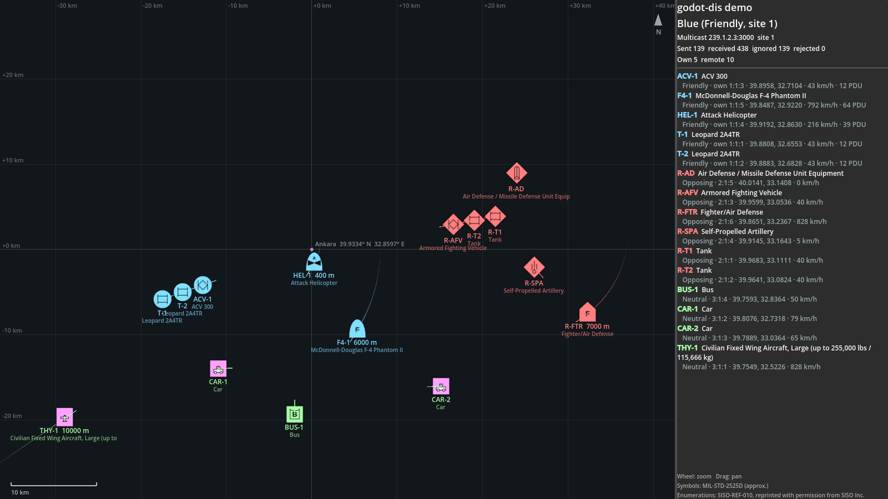

# Demo: a two-sided exercise around Ankara



`demo/main.tscn` is one simulation of a small exercise. Run two copies — Blue and Red — and the civilian traffic
script, and every copy shows all units on a tactical map:

| Who | Site | Force | Units |
|---|---|---|---|
| Godot `--side blue` | 1 | Friendly | 2 × Leopard 2A4TR, ACV 300, attack helicopter, F-4 (Türkiye, SISO-REF-010 country 218) |
| Godot `--side red` | 2 | Opposing | 2 tanks, AFV, self-propelled artillery, air defense, fighter (generic types) |
| `tools/demo_traffic.py` (Open-DIS Python) | 3 | Neutral | airliner at 10 km on a racetrack, two cars, a bus |

Each copy publishes its own units with `DisEntity` (dead reckoning thresholds, heartbeat) and shows everyone's with
`DisEntityManager`: names from `DisEnums`, MIL-STD-2525D symbols from godot-milsymbol. Everything goes over
multicast 239.1.2.3:3000, so the copies can share the port on one computer (see docs/networking.md) or run on
different computers of a LAN.

## Run it (PowerShell, from the repo root)
Once: link godot-milsymbol (without it the map shows plain dots) and import.
```powershell
cd path\to\godot-dis
.\tools\.venv\Scripts\python.exe tools\link_milsymbol.py
& "C:\path\to\godot.exe" --headless --path . --import
```

Then in three terminals:
```powershell
& "C:\path\to\godot.exe" --path . res://demo/main.tscn -- --side blue
```
```powershell
& "C:\path\to\godot.exe" --path . res://demo/main.tscn -- --side red
```
```powershell
.\tools\.venv\Scripts\python.exe tools\demo_traffic.py
```

Mouse wheel zooms, dragging pans; the side panel lists every unit with its source (`own` or site:application:entity),
position and speed, and how many PDUs each own unit has sent. Close one window and its units disappear from the
other at once (it sends a "deactivated" PDU on exit).

Options after `--`: `--side blue|red`, `--seconds N` (quit after N s), `--screenshot file.png` (saved at quit),
`--port N` (a separate exercise, e.g. to test next to a running demo).

`tools/demo_traffic.py` options: `--start S` (skip S seconds ahead along the routes; the airliner reaches its first
turn after ~400 s), `--rate HZ` (updates per second, default 1), `--port N`, `--seconds N`. It sends dead reckoning
algorithm 4 (RVW) with acceleration and turn rate, so receivers follow the vehicles through turns too.

## Watch it in Wireshark
Capture on the loopback adapter (one computer) or the LAN adapter with filter `udp.port == 3000`: Entity State PDUs
from sites 1, 2 and 3. A constant-speed tank sends one PDU every 5 s (heartbeat) plus one per turn; aircraft in a
turn send a few per second, because the routes are polygons.

## Files
- `demo/main.tscn`, `demo/demo_main.gd` — network, origin, manager, own units, UI
- `demo/scenario.gd` — the units of each side; `demo/unit_mover.gd` — moves a unit along its route
- `demo/tactical_map.gd` — the map (grid, symbols, labels, trails)
- `tools/demo_traffic.py` — civilian traffic with Open-DIS Python
