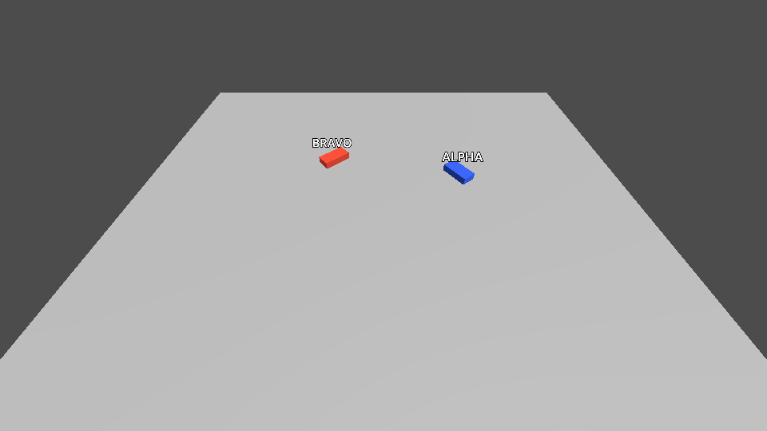

# Getting started

From an empty Godot project to two simulations that see each other over DIS, then a recording of their traffic.
About 15 minutes; no C++ build, only the release zip. Everything is in one GDScript file you can paste.



## What you need
- **Godot 4.3 or newer**, standard (not .NET) build; tested with 4.7.2 ([download](https://godotengine.org/download)).
- **Windows x86_64** or **Linux x86_64**. macOS libraries come from CI and have not been tried yet.
- The release zip **`godot-dis-<version>.zip`** from the
  [releases page](https://github.com/godot-sac/godot-dis/releases) (or the `godot-dis-*` artifact of a CI run).
- Optional: [Wireshark](https://www.wireshark.org/) to look at the packets (step 6).

## 1. Create a project (2 min)
In the Project Manager: **Create**, name it `my_dis`, renderer **Forward+** (Mobile and Compatibility also work),
**Create**. Close the editor again for the next step (or leave it open and restart it after step 2).

From a terminal instead (the rest of this guide works without the editor too; all commands run in the folder
that contains `my_dis`):
```sh
mkdir my_dis
printf 'config_version=5\n\n[application]\n\nconfig/name="my_dis"\n' > my_dis/project.godot
```

## 2. Add the addon (2 min)
Extract the zip **into the project folder**. It contains one folder, `addons/dis/`, so you get:
```
my_dis/
├── project.godot
└── addons/
    └── dis/
        ├── dis.gdextension
        ├── bin/windows/ bin/linux/ (bin/macos/) the compiled extension (debug and release; macOS from CI)
        ├── data/                                 SISO-REF-010 enumerations (see data/NOTICE.txt)
        ├── icons/  dis_enums.gd  tools/dis_cli.gd
        └── LICENSE  THIRD_PARTY_NOTICES.md
```
```sh
unzip ~/Downloads/godot-dis-<version>.zip -d my_dis      # Linux; on Windows: Extract All… into my_dis
```
Then open the project in the editor once, so Godot registers the extension's classes. Without the editor:
```sh
godot --headless --path my_dis --import
```
(`godot` is your Godot executable, e.g. `Godot_v4.7.2-stable_win64_console.exe` or `Godot_v4.7.2-stable_linux.x86_64`.)

**Check:** in the editor, *Scene → New Scene → Other Node* and type `Dis`: `DisNetwork`, `DisEntity`,
`DisEntityManager` and the other classes are listed. If they are not, see [Troubleshooting](#troubleshooting).
Without the editor, step 4 is the check: `... appeared (M1 Abrams)` means the extension works; an error that names
`libgodot_dis.*` means it did not load.

## 3. Make the scene (3 min)
1. *Scene → New Scene*, choose **3D Scene** as the root, rename the root node to `Main`.
2. Right-click `Main` → *Attach Script…*, path `res://main.gd`, template *Object: Empty*, **Create**.
3. Replace the script's text with the code below and save it (*File → Save* in the script editor).
4. Save the scene: *Scene → Save Scene As…*, `res://main.tscn`.
5. *Project → Project Settings → General → Application → Run → Main Scene*: `res://main.tscn`.

```gdscript
extends Node3D
## A vehicle that drives in circles in Üsküdar, Istanbul, and shows every other vehicle on the DIS network
## (godot-dis getting started). Run two copies and each one sees the other.

## Command line, after "--": --name ALPHA  --port 3000  --seconds 20
var vehicle_name := "ALPHA"
var port := 3000
var seconds := 0.0

var _vehicle: Node3D
var _manager: DisEntityManager
var _angle := 0.0
var _time := 0.0


func _ready() -> void:
	_read_arguments()

	# 1. Where the scene's origin is on Earth (latitude, longitude, height above the ellipsoid).
	var origin := DisGeoOrigin.new()
	origin.set_origin_geodetic(41.02, 29.05, 0.0)
	add_child(origin)

	# 2. The network: multicast reaches every copy on this computer and on the LAN.
	var network := DisNetwork.new()
	network.mode = DisNetwork.MODE_MULTICAST
	network.multicast_group = "239.1.2.3"
	network.port = port
	network.site_id = 1
	network.application_id = randi_range(1, 60000)  # every simulation needs its own site / application pair
	add_child(network)

	# 3. Remote entities appear under this node.
	_manager = DisEntityManager.new()
	add_child(_manager)
	_manager.entity_appeared.connect(_on_entity_appeared)
	_manager.entity_removed.connect(_on_entity_removed)

	# 4. Our own vehicle: a blue box with a DisEntity child, which publishes the box's position.
	_vehicle = _box(Color(0.2, 0.4, 1.0), vehicle_name)
	add_child(_vehicle)
	var entity := DisEntity.new()
	entity.marking = vehicle_name
	entity.entity_type = PackedInt32Array([1, 1, 225, 1, 1, 0, 0])  # land platform, USA, tank, M1 Abrams
	entity.force_id = 1  # friendly
	_vehicle.add_child(entity)
	_angle = randf() * TAU  # each copy starts somewhere else on the circle

	# 5. Something to look at.
	var camera := Camera3D.new()
	camera.position = Vector3(0, 40, 35)
	add_child(camera)
	camera.look_at(Vector3.ZERO)
	var light := DirectionalLight3D.new()
	light.rotation_degrees = Vector3(-60, 30, 0)
	add_child(light)
	var ground := MeshInstance3D.new()
	var plane := PlaneMesh.new()
	plane.size = Vector2(100, 100)
	ground.mesh = plane
	add_child(ground)
	print("%s: application %d, port %d" % [vehicle_name, network.application_id, port])


func _process(delta: float) -> void:
	# Drive a 20 m circle at 5 m/s.
	_angle += delta * 5.0 / 20.0
	_vehicle.position = Vector3(20 * cos(_angle), 0.75, 20 * sin(_angle))
	_vehicle.rotation.y = -_angle
	_time += delta
	if seconds > 0.0 and _time >= seconds:
		for remote: DisRemoteEntity in _manager.get_entities():
			print("%s sees %s at %s" % [vehicle_name, remote.marking, remote.position.snapped(Vector3.ONE * 0.1)])
		get_tree().quit()


func _on_entity_appeared(remote: DisRemoteEntity) -> void:
	# Remote entities are plain Node3Ds that dead reckoning moves; give them a red box.
	remote.add_child(_box(Color(1.0, 0.3, 0.2), remote.marking))
	print("%s: %s appeared (%s)" % [vehicle_name, remote.marking, DisEnums.get_entity_type_name(remote.entity_type)])


func _on_entity_removed(remote: DisRemoteEntity, reason) -> void:
	print("%s: %s left (%s)" % [vehicle_name, remote.marking, reason])


func _box(color: Color, text: String) -> Node3D:
	var root := Node3D.new()
	var box := MeshInstance3D.new()
	var mesh := BoxMesh.new()
	mesh.size = Vector3(3, 1.5, 6)
	var material := StandardMaterial3D.new()
	material.albedo_color = color
	mesh.material = material
	box.mesh = mesh
	root.add_child(box)
	var label := Label3D.new()
	label.text = text
	label.font_size = 64
	label.pixel_size = 0.04
	label.outline_size = 16
	label.billboard = BaseMaterial3D.BILLBOARD_ENABLED
	label.position = Vector3(0, 4, 0)
	root.add_child(label)
	return root


func _read_arguments() -> void:
	var args := OS.get_cmdline_user_args()
	for i in args.size() - 1:
		match args[i]:
			"--name": vehicle_name = args[i + 1]
			"--port": port = int(args[i + 1])
			"--seconds": seconds = float(args[i + 1])
```

Without the editor: save the code as `my_dis/main.gd`, then create the scene and set it as the main scene:
```sh
printf '[gd_scene format=3]\n\n[ext_resource type="Script" path="res://main.gd" id="1"]\n\n[node name="Main" type="Node3D"]\nscript = ExtResource("1")\n' > my_dis/main.tscn
printf 'run/main_scene="res://main.tscn"\n' >> my_dis/project.godot
```

What the code does, in the order of `_ready()`:
1. **`DisGeoOrigin`** ties the Godot scene to the Earth: its origin is at the given latitude, longitude and
   height, +X is east, +Y up, −Z north. Every DIS position is converted through it (in doubles).
2. **`DisNetwork`** owns the UDP socket. Multicast group `239.1.2.3` on port 3000 reaches every copy on this
   computer and on the local network. Every simulation needs its own **site / application** pair, so that its
   own packets coming back are not shown as a remote entity; the random application ID takes care of that here.
3. **`DisEntityManager`** turns incoming Entity State PDUs into `DisRemoteEntity` nodes (its children) and moves
   them between updates with dead reckoning. `entity_appeared` is where you give them a look.
4. **`DisEntity`** publishes its parent's position as Entity State PDUs: when it moves or turns more than a
   threshold, and every 5 seconds otherwise. `entity_type` is a DIS entity type (here an M1 Abrams; the names
   come from `DisEnums`). It finds the network and the origin on its own (they are the only ones in the scene).

## 4. Run two copies (3 min)
**In the editor:** *Debug → Customize Run Instances…*, tick **Enable Multiple Instances**, set the count to **2**,
and (optional) give the instances the launch arguments `-- --name ALPHA` and `-- --name BRAVO`. **OK**, then
press **F5**. Two windows open; in each, the blue box is its own vehicle and the red box is the other copy's,
received over DIS. The *Output* panel shows `ALPHA: BRAVO appeared (M1 Abrams)` and the other way round.

**From a terminal**, each copy quits after 15 seconds and says what it saw (leave out `--headless` to see the windows):
```sh
godot --headless --path my_dis -- --name ALPHA --seconds 15 &
godot --headless --path my_dis -- --name BRAVO --seconds 15
```
Expected output (positions vary, the boxes start at random places on the circle):
```
ALPHA: application 26706, port 3000
ALPHA: BRAVO appeared (M1 Abrams)
...
ALPHA sees BRAVO at (6.4, 0.8, 18.9)
BRAVO sees ALPHA at (1.2, 0.8, -20.0)
```
On Windows, run the two commands in two terminals (PowerShell: `& $godot --headless --path my_dis -- --name ALPHA --seconds 15`).
The first time, Windows Defender Firewall may ask about Godot: allow it on private networks.

Other DIS tools on the same network show these vehicles too, and the boxes show theirs: anything that sends
Entity State PDUs to `239.1.2.3:3000` appears as a red box. To keep your test apart from other DIS traffic, give
both copies another port, e.g. `--port 3297`, and use that port instead of 3000 in steps 5 and 6.

## 5. Record the exercise (3 min)
The addon has a command line tool. While the two copies run (start them again with `--seconds 30`), record
their traffic in a third terminal:
```sh
godot --headless --path my_dis -s res://addons/dis/tools/dis_cli.gd -- record exercise.pcapng --mode multicast --group 239.1.2.3 --port 3000 --seconds 10
godot --headless --path my_dis -s res://addons/dis/tools/dis_cli.gd -- info exercise.pcapng
```
Relative file names are inside the project, so the recording is `my_dis/exercise.pcapng`. `info` prints something
like this (about 90 packets: each copy sends about 4–5 updates a second while it turns):
```
file:       exercise.pcapng
start:      2026-11-02 09:21:23 UTC
duration:   9.919 s
packets:    94 DIS datagrams (of 94 frames; skipped: 0 not UDP, 0 fragments, 0 not DIS, 0 other ports, 0 cut off)
exercises:  1
sites:      1:17724, 1:59326
entities:   2 (Entity State PDUs)
PDU types:
    1  Entity State                 94
```
`play exercise.pcapng --mode multicast --group 239.1.2.3` sends it onto the network again: start one copy, replay
the recording, and the copy shows both recorded vehicles. In a game, the same is done by the `DisRecorder` and
`DisPlayer` nodes — see [recording](recording.md).

## 6. Look at the packets (optional, 2 min)
Open `my_dis/exercise.pcapng` in Wireshark: each packet is decoded as *DIS / Entity State* with the entity ID,
the marking (`ALPHA`, `BRAVO`), the entity type and the location. To watch live traffic, capture on the loopback
adapter (or your LAN adapter) with the filter `udp.port == 3000` (or the port you chose). More in
[networking](networking.md#watching-packets-in-wireshark).

## Next steps
- Weapons: `DisEntity.fire()` and `detonate()`, `DisNetwork.fire_received` — [warfare](warfare.md)
- Start, freeze and remove entities from a simulation manager — [simulation management](simulation-management.md)
- Map entity types to your own scenes (`DisEntityTypeMap`), ground clamping on terrain — [entities](entities.md)
- MIL-STD-2525D symbols for remote entities (`DisEnums.entity_type_to_sidc()`, with godot-milsymbol) —
  [enumerations](enumerations.md)
- The two-sided demo of the repository, with a tactical map — [demo](demo.md)

## Troubleshooting
- **`DisNetwork` etc. are not listed / "Identifier not declared in the current scope":** the extension did not
  load. The zip must be extracted so that `my_dis/addons/dis/dis.gdextension` exists (not
  `my_dis/godot-dis-0.1.0/addons/...`). Restart the editor after adding the addon, or run the `--import` command.
  The *Output* panel (or the terminal) names the library file Godot tried to open.
- **Linux: "cannot open shared object file: Permission denied":** the archive tool dropped the permissions;
  `chmod +x my_dis/addons/dis/bin/linux/*.so`.
- **The copies don't see each other:** both must use the same port. Multicast needs a network adapter with an
  IPv4 address (Wi-Fi or Ethernet). VPN clients can take multicast traffic away; see
  [networking](networking.md#windows-notes-found-while-testing). `network.get_statistics()` counts what was
  sent, received and ignored.
- **A copy shows itself as a red box:** two simulations use the same site / application pair; give each its own.
- **Windows: no packets from other computers:** allow Godot in Windows Defender Firewall (private networks).
